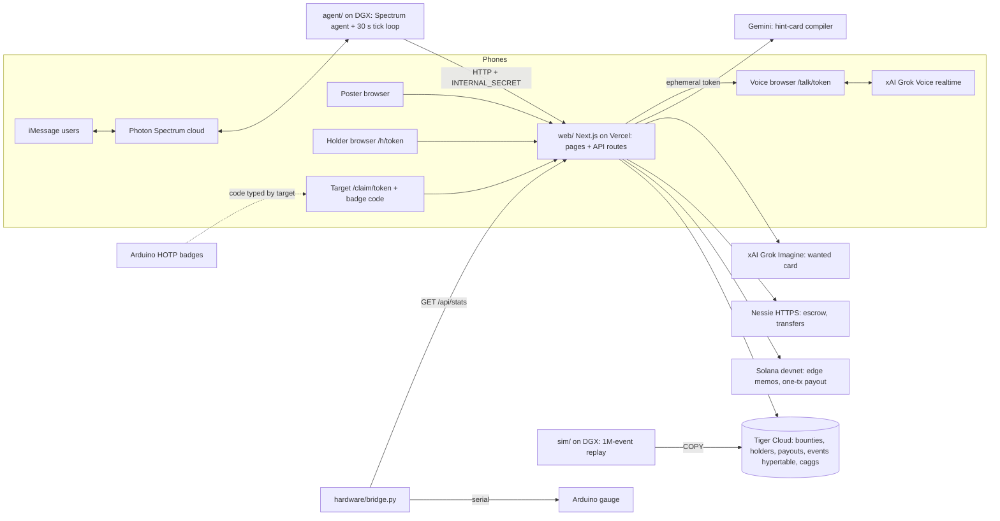

# Six Hops (milgram.study): build plan

Source of truth for what we build. Process (how four people and four agents share the repo) is in [WORKFLOW.md](WORKFLOW.md). What has landed, and what is blocked, is in [PROGRESS.md](PROGRESS.md). Update this file when a measurement or a cut changes the design. Task status goes in PROGRESS.md, not here. Concept and research: [proposals/round-3.md](proposals/round-3.md#1-six-hops-milgramstudy). Sponsor API facts and gotchas: the "Verified 2026-10-03" section of each file in [resources/tracks/](resources/tracks/README.md).

Anything marked **VERIFY** is an API detail we have not run yet. Its go/no-go test (section 10) checks it before anyone builds on it.

---

## 1. What we are building

Post a bounty for a person you cannot search for ("someone who has worked on a launch team at Starbase"). The bounty moves friend to friend. Each holder sees only a hint card and forwards it to at most 3 contacts they think are closer to the target. When the target opts in, the whole chain is paid at once, using a split under which nobody gains by inventing fake hops.

**The pitch in three sentences.**
1. Jon Kleinberg proved strangers can find each other using only local knowledge (Nature 2000), but chains die because nobody has a reason to pass the message on.
2. Paying the chain fixes that, as MIT showed by winning DARPA's Red Balloon challenge, but MIT's payout rule rewards a finder who invents fake recruiters (+94% with 4 fakes).
3. Six Hops pays every chain in one Solana transaction with a split under which fake hops earn the finder exactly zero, and a live controller measures the cascade's branching factor and acts before the search dies.

**Three published results, one product.**
- **Navigability:** greedy forwarding finds short paths (Kleinberg; Milgram 1967; Dodds, Muhamad, Watts 2003).
- **Payout along the chain:** Pickard et al. (Science 2011) paid the chain; Babaioff, Dobzinski, Oren, Zohar ("On Bitcoin and Red Balloons", EC 2012, arXiv 1111.2626) made the split resistant to fake hops.
- **The branching threshold:** Kleinberg and Raghavan ("Query Incentive Networks", FOCS 2005) showed that when the branching factor b drops below 2, the reward needed explodes, so we fix b before we raise money.

---

## 2. Clock

All times are Saturday Oct 3 to Sunday Oct 4, Eastern.

| Time | Milestone | Exit criteria |
|---|---|---|
| 11:30 | **M-1 Scaffold** | S3-01 merged: `web/` Next.js app, `types.ts`, `db.ts`, `.env.example`, `npm run check` passes. Everyone branches from this. |
| 12:30 | **M0 Contracts + go/no-go** | Schema applied on Tiger; split tests pass; go/no-go A to G run and results posted in team chat. |
| 15:00 | **M1 Mock end to end** | On the Vercel URL: post, forward, claim, mock payout, and `/live` shows the cascade from Tiger. Organizer approval for the venue game secured. |
| 17:00 | **Venue game launch** | 5 volunteer targets with badges; launch post in the BRH Discord. |
| 21:00 to 23:00 | **M2 Integration window** | Real devnet payout, Nessie escrow and release, Photon flows, Grok Voice, gauge. **Nobody sleeps in this window.** |
| 03:00 | Feature freeze | Bug fixes only. |
| 05:00 | Code freeze | Only write-ups, deck, and video after this. |
| 08:15 | Devpost submitted | Hard deadline 08:30. |
| 09:00 | Table judging | 2 min pitch plus 2 min Q&A. |

**Sleep shifts (minimum 3 h each).**
- Shift A (SWE1, HW): 23:30 to 03:00.
- Shift B (SWE2, SWE3): 03:00 to 06:00.
- Optional 1 h naps before 17:00 are fine, as long as nobody holding an unmerged M1 task is asleep at 15:00.

---

## 3. Architecture, layout, ownership



**Repo layout.** Software paths have one owner, SWE. Any software person may edit them and claim any SWE task. HW paths stay with HW. Agents edit only their owner's paths. Headings later in this file that still say SWE1, SWE2, or SWE3 are the original split. They do not limit who claims or edits the work.

| Path | Owner |
|---|---|
| `web/**`, `agent/**`, `db/**`, `sim/**` | SWE |
| `hardware/**`, `web/lib/hotp.ts`, `web/lib/hotp.test.ts` | HW |
| **Shared contracts:** `web/lib/types.ts`, `db/schema.sql`, `.env.example`, `web/package.json` + lockfile, section 4 of this file | change only via a CONTRACT PR (WORKFLOW.md section 5) |
| `submission/<track>.md` | one owner per track (section 12) |
| `tasks/**`, `scripts/task.sh`, `PLAN.md`, `WORKFLOW.md` | anyone, small edits |

---

## 4. Contracts

### 4.1 `web/lib/types.ts`

```ts
// Shared contract. Change only via a CONTRACT PR.
export const H = 8;                 // max chain length (people from first recipient to target)
export const FANOUT = 3;            // max forwards per holder
export const INITIAL_SHARE = 0.6;   // bounty starts at 60% of cap; 40% is reserve

export type HintAttr = 'city' | 'organizationType' | 'field' | 'skill' | 'language' | 'experience';
// Attributes only. No name, no street address, by construction.
export interface HintCard {
  city?: string;              // city level only, e.g. "Austin, TX"
  organizationType?: 'company' | 'startup' | 'university' | 'lab' | 'nonprofit' | 'government' | 'other';
  field?: string;             // e.g. "aerospace launch operations"
  skill?: string;             // e.g. "has hand-soldered a QFN chip"
  language?: string;          // e.g. "Amharic"
  experience?: string;        // e.g. "has interned at a launch company"
}

export type BountyStatus = 'open' | 'found' | 'paid' | 'expired' | 'refunded';
export type Rail = 'custodial' | 'wallet' | 'bank';
export type EventKind =
  | 'created' | 'received' | 'opened' | 'forwarded' | 'claimed' | 'confirmed'
  | 'paid' | 'refunded' | 'expired' | 'nudged' | 'widened' | 'raised' | 'edge_memo';

export interface PublicBounty {     // what anyone with a link sees
  id: string; hint: HintCard; bountyCents: number; capCents: number;
  status: BountyStatus; expiresAt: string; ogImageUrl: string;
}
export interface HolderView {       // GET /api/h/[token]
  bounty: PublicBounty; depth: number; forwardsLeft: number; canForward: boolean;
  rail: Rail; parentLabel: string | null; talkUrl: string; claimUrl: string;
}
export interface ForwardRecipient { label: string; handle?: string } // handle = iMessage phone/email, optional
export interface ForwardResult { recipients: { label: string; link: string; delivered: 'imessage' | 'link-only' }[] }

export interface Share { holderId: string; depth: number; role: 'relay' | 'finder'; cents: number; rail: Rail }
export interface SplitResult { chainLength: number; budgetCents: number; shares: Share[]; refundCents: number }
export interface AttackComparison {
  h: number; k: number; budgetCents: number;
  ours: { honestFinder: number; withFakes: number; gainPct: number; posterPays: number };
  mit:  { honestFinder: number; withFakes: number; gainPct: number; posterPays: number };
}
export interface Stats {            // GET /api/stats
  bountyId: string; b: number | null; matureHolders: number; frontier: number;
  holders: number; maxDepth: number; p75LatencyS: number | null;
  controllerStep: 0 | 1 | 2 | 3; status: BountyStatus; asOf: string;
}
export interface GraphPayload {
  nodes: { id: string; depth: number; label: string | null; isTarget: boolean; paidCents?: number }[];
  edges: { from: string; to: string; at: string; memoSig?: string }[];
  payoutSig?: string; explorerUrl?: string; revealedSalts?: Record<string, string>;
}
```

### 4.2 Database (`db/schema.sql`, `db/caggs.sql`, owner SWE3)

```sql
-- db/schema.sql
CREATE TABLE bounties (
  id              TEXT PRIMARY KEY,            -- 'b_' + 8 random base62 chars
  poster_token    TEXT UNIQUE NOT NULL,        -- secret, 128-bit, lets the poster confirm
  hint            JSONB NOT NULL,              -- HintCard (visible attributes)
  hidden_hint     JSONB NOT NULL DEFAULT '[]', -- [{attr, value}] revealed one per "widen" step
  cap_cents       INT  NOT NULL CHECK (cap_cents >= 1000),
  bounty_cents    INT  NOT NULL,               -- current offer; starts at 60% of cap
  status          TEXT NOT NULL DEFAULT 'open',
  target_badge_id TEXT,                        -- venue game: claim needs this badge's HOTP code
  controller_step INT  NOT NULL DEFAULT 0,
  low_b_since     TIMESTAMPTZ,                 -- when b first dropped below 2 (controller)
  nessie_poster_acct TEXT, nessie_escrow_acct TEXT,
  og_png          BYTEA,                       -- Grok Imagine wanted card
  expires_at      TIMESTAMPTZ NOT NULL,
  created_at      TIMESTAMPTZ NOT NULL DEFAULT now()
);

CREATE TABLE holders (
  id              TEXT PRIMARY KEY,            -- 'h_' + 8 random base62
  bounty_id       TEXT NOT NULL REFERENCES bounties(id),
  token           TEXT UNIQUE NOT NULL,        -- 128-bit base64url, appears in /h/[token]
  parent_id       TEXT REFERENCES holders(id), -- NULL for the poster's root holder
  depth           INT  NOT NULL,               -- poster root = 0, first recipients = 1
  label           TEXT,                        -- what the sender called them ("my TA")
  handle          TEXT,                        -- iMessage handle if delivered via Photon
  salt            TEXT NOT NULL,               -- 16 random bytes hex, for the edge commitment
  rail            TEXT NOT NULL DEFAULT 'custodial',
  sol_address     TEXT,                        -- wallet rail, or custodial pubkey
  custodial_secret TEXT,                       -- devnet only; base58 secret key for custodial rail
  nessie_acct     TEXT,                        -- bank rail
  forwards        INT  NOT NULL DEFAULT 0,
  received_at     TIMESTAMPTZ NOT NULL DEFAULT now(),
  opened_at       TIMESTAMPTZ,
  nudged_at       TIMESTAMPTZ
);
CREATE INDEX ON holders (bounty_id);

CREATE TABLE payouts (
  bounty_id   TEXT NOT NULL REFERENCES bounties(id),
  holder_id   TEXT NOT NULL REFERENCES holders(id),
  role        TEXT NOT NULL,                   -- relay | finder | refund
  cents       INT  NOT NULL,
  rail        TEXT NOT NULL,
  tx_sig      TEXT,                            -- Solana signature (same for every SOL share of a bounty)
  nessie_transfer_id TEXT,
  created_at  TIMESTAMPTZ NOT NULL DEFAULT now(),
  PRIMARY KEY (bounty_id, holder_id)           -- idempotency: a holder is paid at most once per bounty
);

-- Append-only event stream. Live and replay share one table.
CREATE TABLE events (
  time       TIMESTAMPTZ NOT NULL,
  bounty_id  TEXT NOT NULL,
  holder_id  TEXT,
  parent_id  TEXT,
  depth      INT,
  kind       TEXT NOT NULL,                    -- EventKind
  latency_s  DOUBLE PRECISION,                 -- on 'forwarded': seconds since this holder received it
  source     TEXT NOT NULL DEFAULT 'live',     -- live | replay
  detail     JSONB
) WITH (tsdb.hypertable, tsdb.segmentby = 'bounty_id', tsdb.orderby = 'time DESC');
-- VERIFY (E): if the WITH syntax errors, use: SELECT create_hypertable('events', by_range('time'));
```

```sql
-- db/caggs.sql
CREATE MATERIALIZED VIEW bounty_minute
WITH (timescaledb.continuous, timescaledb.materialized_only = false) AS
SELECT bounty_id,
       time_bucket('1 minute', time) AS bucket,
       count(*) FILTER (WHERE kind = 'received')  AS received,
       count(*) FILTER (WHERE kind = 'forwarded') AS forwarded,
       count(*) FILTER (WHERE kind = 'opened')    AS opened,
       max(depth)                                 AS max_depth,
       percentile_agg(latency_s) FILTER (WHERE kind = 'forwarded') AS latency  -- timescaledb_toolkit
FROM events
GROUP BY bounty_id, bucket;

SELECT add_continuous_aggregate_policy('bounty_minute',
  start_offset => INTERVAL '3 hours', end_offset => INTERVAL '1 minute',
  schedule_interval => INTERVAL '1 minute');

-- Hierarchical rollup for the replay and the charts.
CREATE MATERIALIZED VIEW bounty_hour
WITH (timescaledb.continuous, timescaledb.materialized_only = false) AS
SELECT bounty_id, time_bucket('1 hour', bucket) AS bucket,
       sum(received) AS received, sum(forwarded) AS forwarded, max(max_depth) AS max_depth,
       rollup(latency) AS latency
FROM bounty_minute GROUP BY 1, 2;

SELECT add_continuous_aggregate_policy('bounty_hour',
  start_offset => INTERVAL '3 days', end_offset => INTERVAL '1 hour',
  schedule_interval => INTERVAL '5 minutes');

-- Columnstore compression for closed cascades (replay data is old, so it compresses right away).
CALL add_columnstore_policy('events', after => INTERVAL '1 day');
-- VERIFY (E): older syntax fallback: ALTER TABLE events SET (timescaledb.compress); SELECT add_compression_policy('events', INTERVAL '1 day');
-- VERIFY (E): if percentile_agg is missing (toolkit not enabled), drop that column and compute p75 with percentile_cont on raw events.
```

**Queries the app runs** (these live in `web/lib/db.ts` helpers, owner SWE3):

```sql
-- p75 hop latency for a bounty (controller + nudges)
SELECT approx_percentile(0.75, rollup(latency)) AS p75
FROM bounty_minute WHERE bounty_id = $1;

-- b: forwards from mature holders / mature holders. Mature = received more than p75 ago (default 10 min).
SELECT count(*) AS mature, coalesce(sum(forwards), 0) AS fwd,
       sum(forwards)::float / nullif(count(*), 0) AS b
FROM holders
WHERE bounty_id = $1 AND depth >= 1
  AND received_at < now() - make_interval(secs => $2);   -- $2 = p75 seconds or 600

-- frontier: holders who could still forward
SELECT count(*) FROM holders WHERE bounty_id = $1 AND forwards < 3 AND depth < 8
  AND received_at > now() - INTERVAL '6 hours';
```

**Benchmark for the Tiger write-up** (S3-03). On the 1M replay rows, record three numbers and show them on `/live`:
- the same per-minute aggregate from `bounty_minute` vs `GROUP BY time_bucket` on raw `events`, in ms (`EXPLAIN ANALYZE`);
- the compression ratio from `hypertable_columnstore_stats('events')` (or `hypertable_compression_stats`);
- refresh lag (`now() - max(bucket)`).

### 4.3 API contract

Auth rules:
- Holder and target endpoints authenticate with the 128-bit token in the URL.
- Poster actions use `poster_token`.
- Internal endpoints need the header `x-six-hops-secret: $INTERNAL_SECRET`.

Every error returns `{ "error": "<code>" }`.

| Method and path | Owner | Request | Response |
|---|---|---|---|
| `POST /api/bounties` | SWE | `{ text?: string, hint?: HintCard, hidden?: {attr,value}[], capCents: number, hours?: number, targetBadgeId?: string, posterRail?: "bank" }` (`text` goes through Gemini when `GEMINI_ENABLED`; otherwise send `hint`) | `201 { bountyId, posterToken, posterLink: "/h/<rootToken>", publicUrl }`. Creates the bounty plus a depth-0 root holder for the poster, Nessie escrow, and the wanted-card job. |
| `GET /api/bounties/[id]` | SWE | | `PublicBounty` |
| `GET /api/h/[token]` | SWE | | `HolderView`; sets `opened_at` and logs `opened` once |
| `POST /api/forward` | SWE | `{ token, recipients: ForwardRecipient[] (1..3 minus forwards used), rail?: Rail, solAddress?: string }` | `200 ForwardResult`. `409 fanout_exceeded`, `409 too_deep` (child depth > 8), `410 closed`. Creates child holders, logs `received` and `forwarded` (with `latency_s`), and fires the edge memo (S2-04) without awaiting it. |
| `POST /api/claim` | SWE | `{ token, badgeCode?: string, introMessage: string }` | `200 { status: "found" \| "paid", payoutSig?, explorerUrl? }`. `401 bad_code`, `409 already_claimed`. See section 5. |
| `POST /api/bounties/[id]/confirm` | SWE | `{ posterToken, accept: boolean }` | `200 { status, payoutSig? }`. Releases the payout for bounties without a badge. |
| `POST /api/attack` | SWE | `{ h: 1..8, k: 0..4, budgetCents }` | `AttackComparison` (pure, no DB) |
| `POST /api/controller/tick` | SWE | header secret | `{ actions: { bountyId, step, kind, nudge?: {handle, text}[] }[] }`. The agent sends each `nudge` over iMessage. Also expires and refunds overdue bounties. |
| `GET /api/stats?bounty=<id>` | SWE | | `Stats`. With no `bounty`, it returns the "featured" bounty (env `FEATURED_BOUNTY`), which the gauge reads. |
| `GET /api/graph/[id]` | SWE | | `GraphPayload`. Revealed salts are included only once the bounty is `paid`. |
| `POST /api/grok/token` | SWE | `{ token }` (holder token) | `{ clientSecret, expiresAt, model }` (VERIFY G) |
| `GET /api/og/[id]` | SWE | | `image/png` wanted card, 1200x630 (fallback: static template rendered with `next/og`) |
| Agent `POST {AGENT_URL}/send` | SWE | header secret, `{ handle, text }` | `{ ok }` |

### 4.4 Environment (`.env.example`)

```
DATABASE_URL=postgres://...tsdb.cloud.timescale.com:.../tsdb?sslmode=require
INTERNAL_SECRET=                 # long random string; web, agent and bridge share it
PUBLIC_BASE_URL=https://milgram.study
FEATURED_BOUNTY=                 # bounty id shown on the gauge and /live by default
PAYOUT_MODE=mock                 # mock | devnet
SOLANA_RPC_URL=https://api.devnet.solana.com
SOLANA_RPC_BACKUP=               # Helius devnet URL
SOLANA_PAYER_SECRET=             # base58 secret key of the devnet treasury (never commit)
DEMO_USD_PER_SOL=150             # fixed demo rate to turn cents into lamports
NESSIE_MODE=mock                 # mock | live
NESSIE_KEY=
NESSIE_TREASURY_ACCT=            # Nessie account that funds SOL-rail shares
PHOTON_ENABLED=false
PHOTON_API_KEY=                  # VERIFY A: exact Spectrum env names
AGENT_URL=http://localhost:8787  # where web reaches the agent (tunnel URL in prod)
GEMINI_ENABLED=false
GEMINI_API_KEY=
GEMINI_MODEL=gemini-3.8-flash
GROK_ENABLED=false
XAI_API_KEY=
HOTP_SECRETS=                    # JSON {"badge1":"<hex secret>",...}
```

Mock flags exist so nobody blocks. With every flag off or mock, the full post, forward, claim and pay loop still runs and writes the same rows and events.

---

## 5. How a bounty is satisfied (lifecycle)

1. **Post.** The poster describes who they need. Gemini compiles the text into a `HintCard`; the attributes-only schema has no name or address field. It also produces an ordered `hidden_hint` list that the controller reveals later. The poster sets a cap of at least $10 and a deadline (default 24 h; venue game until 06:00). The server then:
   1. creates the bounty with `bounty_cents = round(0.6 * cap)`;
   2. creates the poster's Nessie checking account (if `posterRail` is bank or on first use) and an escrow account, and transfers the full cap from checking to escrow;
   3. generates the wanted card;
   4. returns the poster's own forward link (the depth-0 root holder, which is never paid).
2. **Forward.** A holder opens `/h/<token>`, reads the hint card, picks a payout rail (custodial by default, a pasted Solana address, or bank), and forwards to 1 to 3 people. Each recipient becomes a child holder at `depth + 1` with a fresh token, and gets their link by iMessage (if `handle` is set and Photon is on) or as a link the holder copies. Each edge is committed to Solana as a memo of `sha256(salt_parent || salt_child || bountyId || iso_time)`, so edges can be proven later without revealing who is in a losing branch. A recipient at depth 8 cannot forward.
3. **Find.** The person who matches the card opens their link and taps "This is me", which takes them to `/claim/<token>`. They write an intro message and, in the venue game, type the 4-digit code from their badge. This is the **target**. Their depth h is the chain length, and they are the **finder** in the split.
4. **Verify.**
   - **Venue bounties** (`target_badge_id` set): a valid HOTP code proves the target the poster pre-registered, so the claim moves straight to payment.
   - **Other bounties:** the bounty becomes `found`. The poster reads the intro on their link and calls `/confirm` with `accept`. A `false` reopens the bounty and logs `detail.rejected`.
5. **Pay.** In one DB transaction (`SELECT ... FOR UPDATE` on the bounty row; first valid claim wins), the server:
   1. computes `split(h, bounty_cents)` over the chain from depth 1 to the target;
   2. writes `payouts` rows (the primary key makes retries idempotent);
   3. pays the shares on each holder's rail:
      - **custodial or wallet rail:** one Solana transaction carrying every SOL share plus a memo with the hash of the revealed salts;
      - **bank rail:** Nessie transfers from escrow to each holder's account;
      - the SOL portion moves escrow to `NESSIE_TREASURY_ACCT` first, so the bank ledger always balances;
   4. refunds the unspent `cap - bounty_cents` from escrow to the poster;
   5. sets status to `paid` and publishes the winning chain's salts on `/live`.
6. **Expire.** The tick finds bounties past `expires_at` and still `open`. It refunds the full escrow to the poster and logs `expired` and `refunded`.

**Privacy rules** are deterministic code, never an LLM:
- the poster never sees the chain;
- a holder sees only the label their sender gave them;
- the target stays anonymous until they claim;
- hint cards carry attributes only, at city level;
- custodial keys are devnet-only demo keys.

---

## 6. Mechanism (owner SWE2)

### 6.1 Split: Babaioff et al. (beta, H)-almost-uniform

With chain length h (people from depth 1 to the target, inclusive), H = 8 and beta = 1/H, in units:
- each relay (depth 1..h-1) gets beta;
- the finder (the target, depth h) gets 1 + beta*(H - h + 1);
- the total is always 1 + H*beta = 2 units, whatever h is.

Measured in fractions of the budget B, **each relay gets B/16 and the finder gets (17 - h) * B/16**.

```ts
// web/lib/split.ts (exact integer cents; finder absorbs rounding)
export function splitCents(h: number, B: number): { relay: number; finder: number } | null {
  if (h < 1 || h > H) return null;            // h > H: nobody is paid, poster refunded
  const relay = Math.floor(B / 16);
  return { relay, finder: B - (h - 1) * relay };
}
```

| h | Relays each | Finder | Check |
|---|---|---|---|
| 1 | none | 16/16 | 16 |
| 2 | 1/16 | 15/16 | 16 |
| 4 | 1/16 | 13/16 | 3 + 13 = 16 |
| 8 | 1/16 | 9/16 | 7 + 9 = 16 |

**Why fakes do not pay the finder.** If the finder inserts k fake identities above themselves, the chain becomes h + k long. Their identities then collect k/16 + (17 - h - k)/16 = (17 - h)/16, exactly what they got honestly. If h + k > 8, nobody is paid.

**MIT's rule for comparison.** The finder gets X, their recruiter X/2, the next X/4, and so on. With k fakes the finder's identities collect X(2 - 2^-k), so the gain is +50%, +75%, +87.5% and +93.75% for k = 1 to 4. The poster's cost also changes with chain length.

**Honest limits** (say these out loud if asked): a *relay* who inserts fakes moves money from the finder to themselves. The paper proves that is dominated only in equilibrium, and its Theorem 3.1 shows no rule makes it dominated outright for H ≥ 3. Mitigations: a cap of 8, distinct handles for iMessage payouts, and flagging forwards that land within a second of each other (visible in slot order).

**Minimum budget.** A brand-new Solana account needs 650,240 lamports (rent exemption for 0 bytes; `getMinimumBalanceForRentExemption(0)` on `api.devnet.solana.com`, 2026-10-03). At `DEMO_USD_PER_SOL=150`, that is about 9.8 cents, so a relay share B/16 must be at least 10 cents, meaning B ≥ 160 cents. The minimum cap is $10, so B starts at $6 or more and clears this easily. Test B, same day, from treasury `DgGpjfFcuZkvQDpMDyPC7fnbJovzQjpXfycRpLMXuA1a` (5,000,000,000 lamports before the run): five confirmed transactions, each 6 transfers of the rent amount plus memo `sixhops:gonogo`. Times 611, 906, 598, 771, 566 ms. Median 611 ms.

**`split.test.ts`** (node:test, run by `npm run check`) brute-forces every h in 1..8, k in 0..(8 - h), and B in {1000, 1001, 1337, 99999}, asserting:
- shares sum to B exactly;
- the finder's identities' total with k fakes equals their honest total;
- h > 8 returns null;
- the MIT gains come out to 50/75/87.5/93.75%.

### 6.2 Branching factor b and the controller

- **b** = (forwards made by mature holders) / (mature holders), where mature means received more than p75 hop latency ago (600 s until we have data). With fan-out ≤ 3, b ≤ 3. Kleinberg and Raghavan: below 2, the reward needed to finish a search grows exponentially with depth; above 2, linearly.
- **`POST /api/controller/tick`**, every 30 s from the agent, for each `open` bounty:

```
b, p75 = stats(bounty)
if b is null or b >= 2:  low_b_since = null; step stays          # healthy
else if low_b_since is null: low_b_since = now
else if now - low_b_since >= 10 min and step < 3:
   step += 1; low_b_since = now                                   # re-arm the 10-min timer
   step 1 NUDGE:  holders with forwards = 0, received > p75 ago, nudged_at null
                  -> return nudge texts (iMessage handles) + set nudged_at; log 'nudged'
   step 2 WIDEN:  pop the next hidden_hint attribute into hint; log 'widened'
   step 3 RAISE:  if bounty_cents + 0.2*cap <= cap: bounty_cents += 0.2*cap; log 'raised'
expire overdue bounties (section 5 step 6)
```

The controller fixes b before it spends money, which follows from Kleinberg and Raghavan: money alone cannot rescue a search whose b is below 2.

---

## 7. Components

### 7.1 Tiger Data and the replay simulator (SWE3)

- Create a Tiger Cloud service ($1,000 credits for 30 days on signup), apply `schema.sql` and then `caggs.sql`, and share `DATABASE_URL` out of band. Use `pg` with `ssl: { rejectUnauthorized: false }` and keep the pool at 5 or fewer on Vercel. Node's `pg` treats `sslmode=require` as full certificate verification, so the client drops `sslmode` from the URL and sets `rejectUnauthorized: false`.
- **Applied 2026-10-03** on service `hldtuqlvht` (BRH26, us-east-1, ready): `events` hypertable, `bounty_minute` with `percentile_agg`, `bounty_hour` with `rollup`. A 1,000-row insert took 22 ms. The columnstore policy was already present, so the compression fallback did not run. **VERIFY E (2026-10-03):** `COPY` of 100,000 rows took 1,711 ms. `EXPLAIN ANALYZE` on bounty `b_copy100k` was 85.574 ms raw and 0.928 ms on `bounty_minute` (92x). After refresh, `now() - max(bucket)` was 62.5 s, in line with the 1-minute cagg end offset. Chunk compression stats were still empty because the rows are newer than the 1-day columnstore policy.
- **`sim/replay.py`** (numpy, on the DGX):
  - builds a 1000 x 1000 Kleinberg lattice (local links plus one long-range link per node with P proportional to d^-2);
  - runs about 2,000 cascades toward random targets, with fan-out ≤ 3 picking the neighbors closest to the target, per-hop attrition p ~ U(0.2, 0.6), and lognormal hop latency (median 20 min);
  - writes about 1M rows matching `events` (`source='replay'`, bounty ids `r_0001`...) to `replay.csv`, spread over the past 7 days so the columnstore policy compresses them.
  - Load: `psql "$DATABASE_URL" -c "\copy events FROM 'replay.csv' CSV HEADER"`, then `CALL refresh_continuous_aggregate('bounty_minute', NULL, NULL);`
  - Also outputs `sweep.json`: success rate vs attrition and vs fan-out, which shows the b = 2 cliff. `/live` charts it.

### 7.2 Solana (SWE2)

- Use `@solana/web3.js` 1.x (fastest to write; Phantom Pool already used it).
- The treasury keypair is loaded from `SOLANA_PAYER_SECRET` (base58 via `bs58`). Pre-fund it with at least 5 devnet SOL from faucet.solana.com and keep the Helius RPC as backup.
- **Edge memo:** a transaction with one Memo instruction (program `MemoSq4gqABAXKb96qnH8TysNcWxMyWCqXgDLGmfcHr`) and data `sixhops:edge:<bountyId>:<sha256hex>`. Store the signature in `events.detail.memoSig` (kind `edge_memo`).
- **Payout:** one `Transaction` with one `SystemProgram.transfer` per SOL-rail share (at most 8) plus one Memo, `sixhops:pay:<bountyId>:<sha256(revealed salts)>`. Send it with `sendAndConfirmTransaction(..., { commitment: 'confirmed' })`. 8 transfers plus a memo fit under the 1,232-byte limit. Custodial-rail holders get a server-generated `Keypair`; only the pubkey is shown to them.
- **Idempotency:** payouts are written in the claim transaction first. On retry, if a `tx_sig` exists, return it; if not, resend.
- **Explorer link:** `https://explorer.solana.com/tx/<sig>?cluster=devnet`.
- **Measured 2026-10-03:** `claimBounty` then `confirmBounty` with `PAYOUT_MODE=devnet` paid one custodial hop of 1600 cents. Confirmed signature `61a5bLrJdUqZkYqjvptTqJ5KGqj2dGWdhvSjoDrgJG16sTwwNqkdNbTcdbbRphtmxRyFjFbz3kuMqgbPU7NjQiXS`: one System transfer plus memo `sixhops:pay:b_devnet:517b99550caf87c1eeaa7a41133ed6389c47659d8528b485e43982d5c6bdc209`. The same path against `db/schema.sql` confirmed `2YGGHMZuvB7Ryx4RQWZpBHH5Lod18KerchMJR21Zqmh3rNUkGhNLRGY5CrRCZoYMKk1VVHTvc4MhCZuFSNgCeNo9` for bounty `b_schema`. `/live` links the first signature when stats and graph are down.
- **`PAYOUT_MODE=mock`:** return a fake signature `mock_<bountyId>` and change nothing else.

### 7.3 Capital One Nessie (SWE2)

Base URL is `https://api.nessieisreal.com`; use HTTPS only, because plain HTTP resets on the Cornell network. The key goes in `?key=`.
- `POST /customers` creates the poster (and a bank-rail holder): `{first_name, last_name, address:{street_number, street_name, city, state, zip}}`. Use placeholder names, never real ones.
- `POST /customers/{id}/accounts` with `{type:"Checking", nickname, rewards:0, balance}` creates the poster checking (balance = cap + $50), the bounty escrow (balance 0), and holder accounts.
- `POST /accounts/{id}/transfers` with `{medium:"balance", payee_id, amount, description}` moves money: checking to escrow on post; escrow to holders and treasury on pay; escrow to checking on refund.
- `GET /accounts/{id}` reads balances for the `/live` money panel.
- **VERIFY D (2026-10-03, failed):** customer and two checking accounts create, and the initial balances stick (checking 50, escrow 0). `POST /accounts/{id}/transfers` rejects `medium` and `payee_id`. The body it accepts is `{transaction_date, status, amount, description}` and returns 201, with no payee. A completed transfer, a deposit, a withdrawal, and `PUT` balance all left the GET balances unchanged for 2 minutes. `NESSIE_MODE` stays `mock`. The client keeps the planned payee body for the local stand-in.

### 7.4 Photon iMessage agent (SWE1)

`agent/` is a Node/TS process on the DGX or a laptop. Use the HACKWITHPHOTON Pro plan, and set it up from the Spectrum docs (https://photon.codes/docs/spectrum-ts/getting-started). **VERIFY A (2026-10-03, partial):** `spectrum-ts@12` installs; credentials are `SPECTRUM_PROJECT_ID` + `SPECTRUM_PROJECT_SECRET` (docs also accept `PROJECT_ID` / `PROJECT_SECRET`). S1-05 flows in `agent/`: link→hint, tapback/yes→name→`POST /api/forward`, "this is me"→claim URL, `POST /send`, 30 s controller tick, privacy sanitizer. Terminal provider runs without Photon keys. Live iMessage go/no-go (registered forward + nudge + paid) was **not** run — no Spectrum secrets. Re-run with `PHOTON_ENABLED=true` + `PUBLIC_BASE_URL` + `DATABASE_URL` before the Photon track demo.

- **Registered numbers only:** register team phones and judges at the table; everyone else uses links.
- **Inbound:**
  - a message containing a Six Hops link token: the agent links that handle to the holder and replies with the hint card;
  - a tapback, or "yes"/"pass": reply asking who to send it to;
  - a first name or contact card: call `POST /api/forward` and reply with the personal link to forward (or deliver it directly if the recipient's handle is registered);
  - "this is me": reply with the claim link.
- **Outbound:**
  - `POST /send` (secret header) for nudges from the tick;
  - "found" to every holder in the winning chain;
  - "you were paid X" with the Explorer link.
- **Loop:** every 30 s, call `POST /api/controller/tick` and deliver the returned nudges.
- **Rules are code, not an LLM:** never reveal chain members, the target, or other holders' handles.
- **Limits:** the Pro shared line messages only registered numbers (others get "Target not allowed"), and one source reports 50 new conversations per day. Expose the agent with a tunnel (`cloudflared tunnel --url http://localhost:8787`) and put the URL in Vercel `AGENT_URL`.

### 7.5 SpaceX: Cursor + Grok (SWE3 voice, SWE1 imagine)

- **Grok Voice** (`/talk/[token]`): a "talk instead" button for holders who would rather speak, in 20+ languages.
  - The server route `POST /api/grok/token` mints an ephemeral client secret; the raw `XAI_API_KEY` never reaches the browser.
  - The browser opens `wss://api.x.ai/v1/realtime?model=grok-voice-latest` with session instructions ("read this hint card in the user's language; help them pick who to forward to") and three client tools: `get_bounty()`, `forward_to({label, handle?})` and `claim({introMessage})`, which call our API with the holder token.
  - Audio is PCM 24 kHz from `getUserMedia`.
  - **VERIFY G (2026-10-03, partial):** Mint via `POST https://api.x.ai/v1/realtime/client_secrets` with body `{ expires_after: { seconds: 300 } }` → `{ value, expires_at }`. Our route: `POST /api/grok/token` with holder `{ token }` → `{ clientSecret, expiresAt, model, wsUrl }` when `GROK_ENABLED=true` and `XAI_API_KEY` set (else 503 `grok_unavailable`). Browser WS: `wss://api.x.ai/v1/realtime?model=grok-voice-latest` with protocol `xai-client-secret.${clientSecret}`. Session events used in the probe: `session.update` (tools include `get_bounty`), inbound log of `type` frames (e.g. `response.output_audio.delta` per xAI voice docs). Live mint + browser tool call + Imagine image were **not** run — no `XAI_API_KEY` in this session. Unit-tested mint mapping in `web/lib/grok.test.ts`.
- **Grok Imagine wanted card:** on bounty creation, call `POST https://api.x.ai/v1/images/generations` with `{model:"grok-imagine-image", prompt:<wanted-poster prompt built from the hint card, no names>, response_format:"b64_json"}` ($0.02 per image). Store the bytes in `bounties.og_png` and serve them at `/api/og/[id]`. `/h/[token]` sets `og:image` through `generateMetadata`, so every forwarded link previews as a wanted poster. With `GROK_ENABLED=false`, render a `next/og` template instead.
- **Cursor evidence:** see WORKFLOW.md section 8.

### 7.6 Gemini (SWE1, first to cut)

`web/lib/hintcard.ts` takes the poster's free text and calls `GEMINI_MODEL` with structured output (a JSON schema matching `HintCard` plus a `hidden` array). Instruction: drop any person name or street address, and generalize places to city level. The server re-validates: unknown keys are dropped and strings are limited to 80 characters. Fallback: the `/post` form edits the HintCard fields directly.

### 7.7 GoDaddy Registry (SWE3)

Claim `milgram.study` through the MLH GoDaddy Registry offer (https://www.tech.study/; get the claim code from the MLH prizes page or a coach). Point it at Vercel. Fallback: any `sixhops.*` the offer allows. Register it by 13:00 so link previews use the real domain.

### 7.8 Hardware and game ops (HW)

- **Target badges (2 to 3):** Arduino Uno + Grove base shield + Grove 4-digit display (TM1637) + Grove button, powered by a USB power bank, in a 3D-printed lanyard case.
  - Pressing the button increments an EEPROM counter and shows `HOTP(secret, counter) mod 10^4` (RFC 4226 HMAC-SHA1 with dynamic truncation; 4 digits because of the display).
  - No clock is needed, and the code survives power cycles.
  - Libraries: `TM1637Display` (Avishay Orpaz) and an HMAC-SHA1 implementation such as the `Sha1` class in Cryptosuite; VERIFY F in Library Manager.
  - Per-badge secrets are flashed from `hardware/secrets.h` (gitignored) and mirrored in `HOTP_SECRETS`.
- **`web/lib/hotp.ts`:** accepts a code if it matches any counter in [last+1, last+10] (a look-ahead window knob), then stores the new counter in `detail` on the `claimed` event. It allows 5 failed attempts per bounty per 10 minutes. `hotp.test.ts` uses the RFC 4226 Appendix D test vectors (6-digit), plus mod 10^4.
- **Gauge:** a servo needle on a printed dial (0 to 3, red zone below 2) plus red/amber/green LEDs. `hardware/bridge.py` polls `GET /api/stats` every 5 s and writes `B 1.73\n` over serial at 9600 baud; the firmware maps b to an angle with calibration constants `ANGLE_MIN` and `ANGLE_MAX` (servos vary, so tune them on the bench).
- **Fallback (F fails):** printed one-time code cards (each code valid once) replace the badges, and the gauge becomes the hardware piece.
- **Game ops:**
  - get organizer approval by 15:00 ("an opt-in forwarding game, no real money, volunteers as targets");
  - recruit 5 volunteer targets (hackers or organizers) and write each one's hint card with them;
  - launch in the BRH Discord at 17:00 with one bounty link per target;
  - check the cascade every 2 h overnight;
  - export the data at 06:00.

### 7.9 Web app and UI

- **SWE1 pages:**
  - `/` explains the game in one screen and lists the featured bounty;
  - `/post` takes free text or the form, cap, and deadline;
  - `/h/[token]` shows the wanted card, hint card, depth ("you are hop 3 of at most 8"), forward form (1 to 3 rows: label, optional iMessage handle), rail picker, a "talk instead" link, and a "this is me" link;
  - `/claim/[token]` takes the intro message and badge code, then shows a success screen with the Explorer link.
  - Mobile first, since most opens come from phones.
- **SWE3 `/live`, the demo screen:**
  - d3-force cascade colored by depth, with paid nodes glowing and edges linking to their memo signatures;
  - the b gauge (red/amber/green, threshold 2) and a time series from `bounty_minute`;
  - controller step indicator;
  - **attack slider** (k = 0..4 fakes) calling `/api/attack`, with MIT and ours side by side;
  - replay scrubber over the 1M-event replay with the `sweep.json` chart;
  - Tiger benchmark numbers;
  - Nessie balances panel;
  - payout Explorer link.

---

## 8. Tasks

The authoritative list is `tasks/<ID>.md`: one file per task, with owner, dependencies and done-when. Claim and track them with `scripts/task.sh` (WORKFLOW.md section 3). Summary:

| ID | Owner | Task | Depends | Est h | By |
|---|---|---|---|---|---|
| AL-01 | ALL | Accounts and keys: Tiger, Vercel team, Solana devnet treasury, Nessie, xAI, Photon (HACKWITHPHOTON), Gemini, Cursor | none | 0.5 | 11:00 |
| S3-01 | SWE | Scaffold `web/` (Next.js TS, `types.ts` from 4.1, `db.ts`, `.env.example`, `npm run check`, `.gitignore`), Vercel project | none | 1 | 11:30 |
| S2-01 | SWE | `split.ts` + `split.test.ts` | S3-01 | 1 | 12:00 |
| S1-01 | SWE | Go/no-go A: Photon echo agent | AL-01 | 1 | 12:30 |
| S2-02 | SWE | Go/no-go B (Solana) + D (Nessie) | AL-01 | 1 | 12:30 |
| S3-02 | SWE | Go/no-go E: Tiger service, apply schema + caggs | S3-01 | 1 | 12:30 |
| HW-01 | HW | Go/no-go F: parts inventory, HOTP on one Uno, start printing the badge case | none | 1.5 | 12:30 |
| S3-06a | SWE | Go/no-go G: Grok key, ephemeral token, one tool call | AL-01 | 0.5 | 12:30 |
| S1-02 | SWE | `bounty.ts` + bounties, h, forward APIs (mock memos) | S3-02 | 3 | 15:00 |
| S1-03 | SWE | Pages `/`, `/post`, `/h/[token]`, `/claim/[token]` | S1-02 | 2.5 | 15:00 |
| S2-03 | SWE | `/api/claim` + `/confirm` + `payout.ts` in mock mode | S2-01, S1-02 | 2 | 15:00 |
| S2-04 | SWE | `/api/attack` | S2-01 | 0.5 | 15:00 |
| S3-03 | SWE | `sim/replay.py`, load 1M rows, benchmark numbers | S3-02 | 3 | 17:00 |
| S3-04 | SWE | `/api/stats`, `/api/graph/[id]` | S3-02 | 1.5 | 15:00 |
| S3-07 | SWE | Domain milgram.study on Vercel | AL-01 | 0.5 | 13:00 |
| HW-02 | HW | Badge firmware + `hotp.ts` + `hotp.test.ts` | HW-01, S3-01 | 2.5 | 15:00 |
| HW-03 | HW | Organizer approval, 5 targets, hint cards, Discord post draft | none | 1.5 | 15:00 |
| S1-04 | SWE | Grok Imagine wanted card + `/api/og` + og meta | S1-02 | 1.5 | 19:00 |
| S1-05 | SWE | Photon agent flows + `/send` + 30 s tick loop, deployed on the DGX | S1-01, S1-02 | 4 | 21:00 |
| S2-05 | SWE | `solana.ts`: edge memos + one-tx payout (devnet) | S2-02, S2-03 | 3 | 21:00 |
| S2-06 | SWE | `nessie.ts`: escrow, release, refund, treasury | S2-02, S2-03 | 2.5 | 21:00 |
| S2-07 | SWE | `controller.ts` + `/api/controller/tick` + expiry | S3-04 | 2.5 | 21:00 |
| S3-05 | SWE | `/live` visualizer, attack slider, replay, benchmarks, balances | S3-04, S2-04 | 4 | 21:00 |
| S3-06 | SWE | Grok Voice `/talk/[token]` | S3-06a, S1-02 | 3 | 21:00 |
| HW-04 | HW | Launch the venue game at 17:00, monitor overnight | S1-03, HW-02, HW-03 | ongoing | 17:00 |
| HW-05 | HW | Gauge hardware + `bridge.py` | S3-04 | 2 | 21:00 |
| S1-06 | SWE | Gemini hint-card compiler (cut first) | S1-02 | 1 | 23:00 |
| AL-02 | ALL | M2 integration: real payout, Nessie, Photon, voice, gauge, smoke test | all M2 tasks | 2 | 23:00 |
| HW-06 | HW | Main deck PDF on Drive | none | 2.5 | 06:30 |
| AL-03 | ALL | Backup demo video (2 min screen recording) | AL-02 | 1 | 06:00 |
| AL-04 | ALL | Per-track write-ups + Devpost + make repo public | AL-02 | 2 | 08:15 |

---

## 9. How each track is satisfied

Each sponsor gets one spoke: a real, working feature that only that sponsor's properties justify. Following the Phantom Pool pattern, each also gets its own write-up, `submission/<track>.md`, structured as short description, "Why <sponsor> specifically" (3 to 5 property-based reasons), where it is in the code, and what to look at in the demo.

| Track | Hard requirement | How Six Hops satisfies it | What the judge sees | Write-up owner | p_win |
|---|---|---|---|---|---|
| **MLH Solana** | Use Solana | Per-edge salted commitment memos; the whole chain paid in one atomic multi-transfer transaction | The Explorer tx with N transfers + memo, about 2 s after the claim | SWE | 0.45 |
| **MLH Tiger Data** | Use Tiger Data | Events hypertable; `bounty_minute` cagg with real-time aggregation and `percentile_agg` driving the controller's p75; hierarchical rollup; columnstore over the 1M replay | Cagg vs raw ms, compression ratio, refresh lag on `/live` | SWE | 0.35 |
| **Photon iMessage** | Spectrum integration | Agent in 1:1 threads: deliver bounty, tapback to pass on, name to personal link, nudges from the controller, found and paid messages, deterministic privacy rules | A judge registered at the table forwards a bounty from their own iMessage | SWE | 0.28 |
| **BigRed (main)** | Theme: Navigation | Decentralized search through a social network, built on the keynote speaker's papers | The whole demo | HW (deck) | 0.24 |
| **Capital One Nessie** | Nessie API | Real escrow account per bounty; release only after target opt-in and poster confirm (or badge proof); refund on expiry; bank-rail payouts | Balances panel moving on claim; refund on an expired bounty | SWE | 0.22 |
| **SpaceX Make it Legendary** | Built with Cursor + Grok Imagine or Voice | Grok Voice "talk instead" with 3 tools in 20+ languages; Grok Imagine wanted card as the link preview; whole team in Cursor | Voice forward in another language; wanted card in the iMessage preview; Cursor transcripts in the repo | SWE | 0.22 |
| **MLH GoDaddy Registry** | Domain via GoDaddy Registry | milgram.study ("Milgram study", the 1967 experiment we replicate) hosts everything | The URL on every link | SWE | 0.22 |
| **Software** | (judged) | Babaioff split with brute-force proof test, controller, strict contracts | `split.test.ts` output, architecture slide | SWE | 0.22 |
| **Hardware** | (judged) | HOTP target badges (EEPROM counter, no clock) and the live b gauge | Target presses badge, types code, gets paid; gauge needle moves | HW | 0.20 |
| **People's Choice** | Upvotes | Every game player got a link; one opt-in "your chain found them, vote here" message after 08:30 | | HW | 0.20 |
| **Design** | (judged) | `/live` cascade, gauge, attack slider; mobile hop page; wanted cards | `/live` on the big screen | SWE | 0.15 |
| **MLH Gemini API** | Use Gemini | Structured-output hint-card compiler that strips names | `/post` turning a messy request into a card | SWE | 0.05 |
| ElevenLabs, Presage | | **Not entered**: no honest fit | | | |

Is BigRed stackable with sponsor prizes? This is unverified; ask an organizer.

---

## 10. Go/no-go tests (all by 12:30)

A failed test cuts that spoke, not the project.

| ID | Owner | Test | If it fails |
|---|---|---|---|
| A | SWE | A Spectrum agent on Pro receives a text and a tapback from a registered number and replies within 5 s; a sent URL renders as a rich link; log what a contact card arrives as; an unregistered number gets "Target not allowed" | Drop Photon; links only |
| B | SWE | A devnet tx with 6 transfers to fresh keypairs + memo confirms (median < 2 s over 5 runs); `getMinimumBalanceForRentExemption(0)` matches section 6.1; the treasury holds ≥ 5 SOL | Keep `PAYOUT_MODE=mock`, then retry with the backup RPC |
| C | SWE | `npm run check` passes `split.test.ts` | It's a bug; fix it |
| D | SWE | Over HTTPS: create a customer, 2 accounts and a transfer; both balances change on GET within 2 min | `NESSIE_MODE=mock`, drop the track |
| E | SWE | `schema.sql` + `caggs.sql` apply; COPY 100k rows in < 30 s; the cagg answers ≥ 10x faster than the raw scan | Use the fallback syntax noted in 4.2 |
| F | HW | ≥ 2 TM1637 displays + buttons in stock; a code verifies against `hotp.ts` and still verifies after a power cycle; the power bank lasts 30 min | Printed one-time code cards; the gauge is the hardware |
| G | SWE | The xAI key has credits (or prepay $10); the server mints an ephemeral token; a browser voice session calls one tool; one Imagine image returns | `GROK_ENABLED=false`, Imagine only, or drop SpaceX |

---

## 11. Cut order if behind

At 21:00, cut from the top of this list down:
1. Gemini compiler
2. Grok Voice (keep Imagine)
3. contact-card intake in Photon
4. Nessie bank rail (keep Nessie escrow if it works)
5. gauge
6. controller step 3 (raise)
7. venue game (lead with the replay)

**Never cut:** split + attack slider, one-tx Solana payout, `/live` with the replay, the claim flow.

---

## 12. Demo (2 min) and Q&A

1. **0:00 to 0:20.** "The person you need is usually 2 to 4 hops away in someone's private contacts. Jon Kleinberg proved strangers can find each other with local knowledge alone. We made the chain pay, correctly."
2. **0:20 to 0:50.** `/live` shows the overnight game: real cascades and their depths next to the 1M-event replay. Point to where b fell below 2 and the controller widened the hint; the physical gauge on the table moves with it.
3. **0:50 to 1:15.** A judge (registered at the table) gets a fresh bounty in iMessage with the wanted-card preview. They reply with a name, and a new edge appears on the graph.
4. **1:15 to 1:40.** A teammate plays the target: presses the badge, types the code, opts in. Within about 2 s one devnet transaction pays every hop; open it in Explorer. The Nessie panel shows escrow released.
5. **1:40 to 2:00.** Attack slider: the finder adds 1 to 4 fake recruiters. MIT pays +50/75/88/94%; ours pays +0, and the poster's total is unchanged.

**Fallbacks:**
- the backup video (AL-03);
- if Photon is down, use the `/h` link on a phone;
- if devnet is slow, show the last good payout signature.

**Q&A crib:**
- **"Pyramid scheme?"** Nobody pays to join. Money flows one way, from one poster, and the poster's total is fixed whatever the chain length; depth is capped at 8.
- **"Stalking?"** Attributes only, city level, no names. The target opts in, and the poster never sees the chain.
- **"Relay fakes?"** Be honest: equilibrium-dominated only (Theorem 3.1), plus our mitigations.
- **"Why not LinkedIn?"** It needs a central copy of everyone's graph. We never see the network; humans route.
- **"Why Solana?"** One atomic multi-payee tx for a fraction of a cent and no contract, plus timestamped edge commitments nobody can backdate.
- **"Play money?"** Devnet and Nessie are mock money, so the overnight run is incentive-shaped, not incentive-tested. Only the RPC changes for mainnet.
- **"Does it work?"** Show the replay sweep, then the real game numbers as they are.

---

## 13. Submission checklist (owner of each line in brackets)

- [ ] Repo public at 07:30, after a secret scrub (`git log -p | grep -iE "secret|key=|PRIVATE"`) [SWE]
- [ ] Deck PDF on Google Drive: name and members, problem, solution + screenshots, tech stack, impact [HW]
- [ ] Devpost sections (Inspiration, What it does, How we built it, Challenges, Accomplishments, What we learned, What's next) [SWE drafts, all review]
- [ ] `submission/{solana,nessie,software,tiger,spacex,design,godaddy,photon,gemini}.md` [SWE], `{hardware,bigred}.md` [HW]
- [ ] Tick tracks: BigRed, Software, Hardware, Design, People's Choice, Solana, Tiger Data, Photon, Nessie, SpaceX, GoDaddy, Gemini [SWE]
- [ ] Cursor evidence: transcripts exported to `cursor-transcripts/`, Co-authored-by trailers visible, screen recording [everyone]
- [ ] Backup video link [SWE]
- [ ] People's Choice share push right after 08:30 [HW]

---

## 14. Risks

- **Thin live data.** Lead with the replay, labeled synthetic, and show real numbers as they are.
- **Photon:** registered numbers only. Links are the main path; register judges at the table.
- **Nessie writes untested.** Go/no-go D decides.
- **Grok credits unverified.** Budget a $10 prepay.
- **Vercel to Tiger connections.** Keep the pool small and test from Vercel at M1, not at M2.
- **Network:** the Cornell network blocks plain HTTP to Nessie, and the DGX is behind NAT, so the agent connects only outbound and uses a tunnel for `/send`. Test everything from cellular.
- **Scope:** seven spokes for three SWEs. Follow the cut order without debate.
